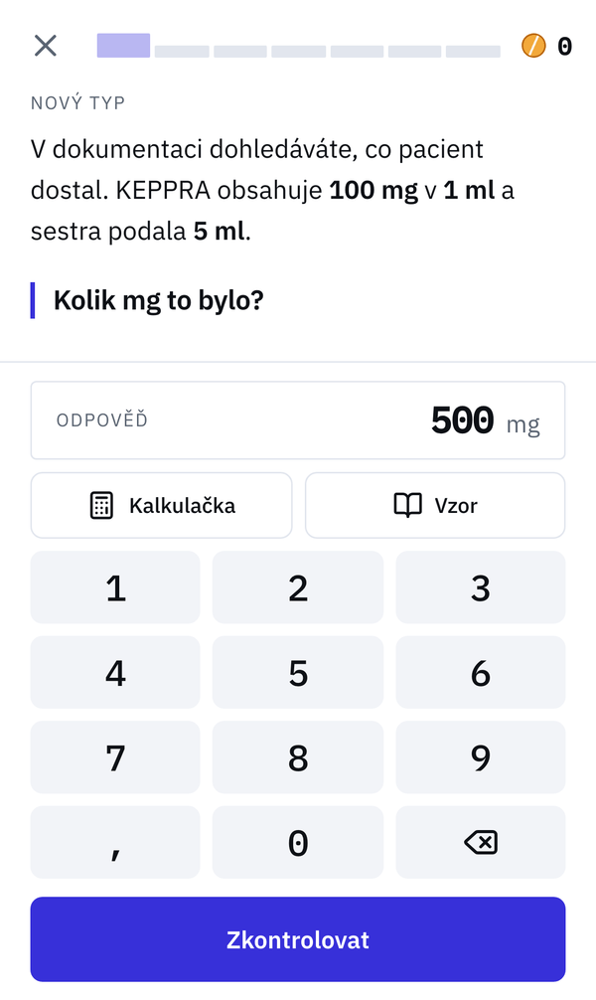
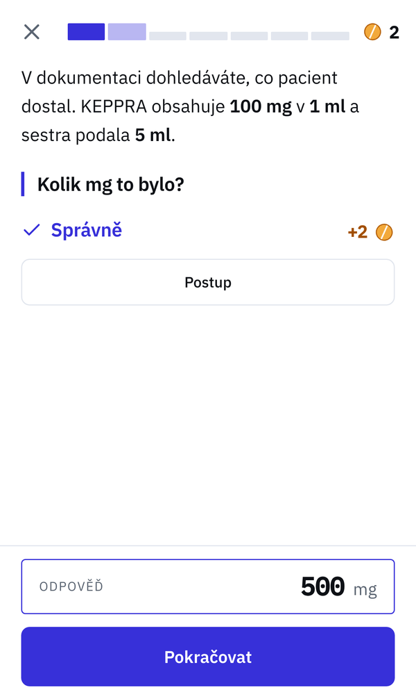
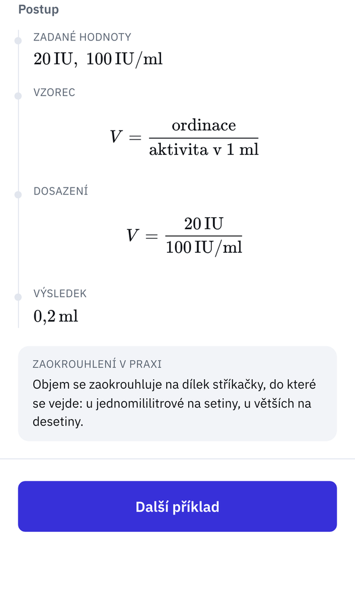
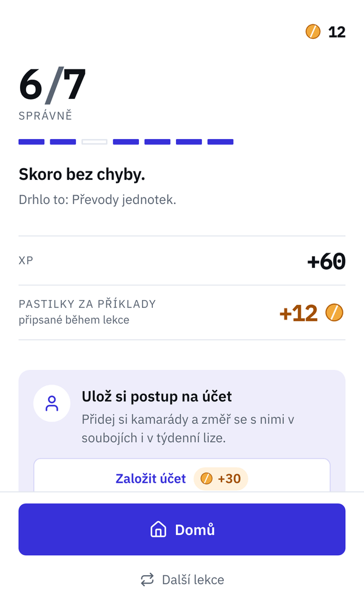
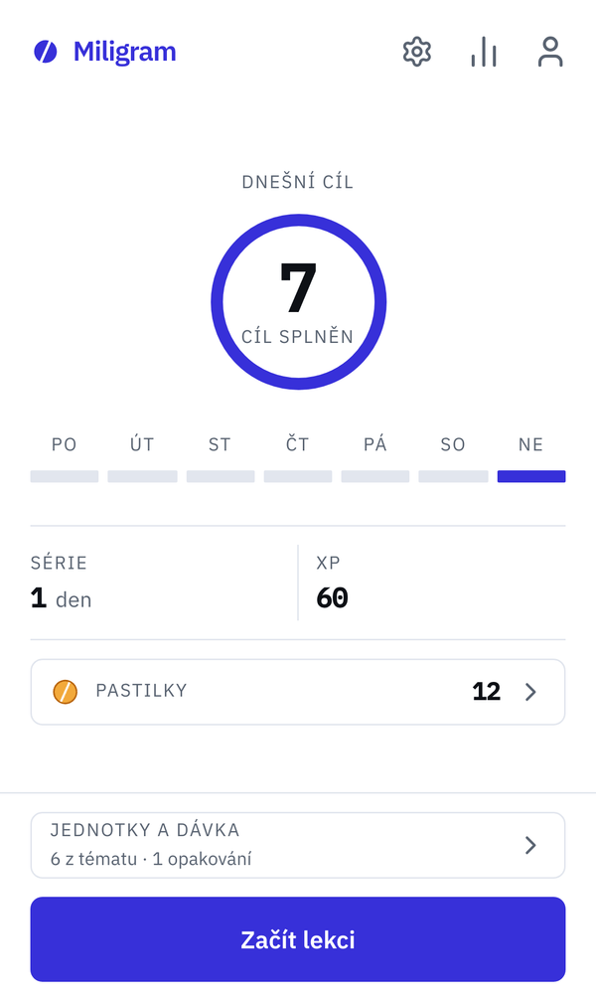

# Miligram

Drug dosage calculation training for Czech and Slovak medical students.
An offline-first Progressive Web App: add it to your home screen and it works without a connection.

**Try it: [miligram-app.pages.dev](https://miligram-app.pages.dev)** (Czech and Slovak UI)

<p>
  
  
  
  
  
</p>

> **A study tool.** Miligram is not meant for calculating doses for real patients.

## What it does

Students practise the calculations they will do on the ward: tablets and ampoules,
mg/kg dosing, body surface area, dilutions, reconstitution, infusion rates,
vasoactive drugs, unit conversions, insulin, renal dosing, paediatrics and oncology.

- **72 exercise types in 12 topics**, generated from real products: 600+ preparations
  taken from the Czech drug registry (SÚKL) with their actual strengths and packaging.
- **Realistic doses.** Every generated dose stays within the range
  the product's SmPC gives for that patient and dosage form. Tests enforce the bounds,
  and every factual value carries its source and verification date.
- **Step-by-step solutions** typeset with KaTeX, a solved example on request, and notes
  on how the result is rounded in practice.
- **Lessons of seven exercises** with rising difficulty. A wrong answer comes back later
  in the lesson until it is solved; spaced review brings back past mistakes.
- **Motivation without punishing learning.** Streaks, XP, a weekly league, friends and
  head-to-head duels. Accuracy, mistakes and hints stay private, so nobody avoids hints
  or harder topics to look good.

## Under the hood

- **Next.js (App Router) as a static export**, served from Cloudflare Pages. No server
  rendering, so the whole app can be precached by a custom service worker.
- **Local-first data.** Game state lives on the device in IndexedDB (Dexie). The app works
  fully without an account; sync is an optional layer on top.
- **Event-based sync.** The device queues what happened, not the resulting state, so two
  phones that were offline cannot overwrite each other.
- **Supabase** (Postgres, Row Level Security, Edge Functions) for accounts, friends,
  leagues, duels and push notifications. With a static frontend there is nowhere to hide
  access checks, so every rule lives in the database and public scores are computed
  server side.
- **Language-free calculation core.** `src/core` returns only tokens and numbers;
  Czech and Slovak text is added in the view layer (`next-intl`). A test enforces it.
- **Custom numeric keypad** instead of the system one, which on iOS covers the answer
  button and offers characters that make no sense in an answer.
- 660+ unit tests (Vitest), TypeScript throughout, WCAG 2.1 AA audited with axe-core.

## Running locally

```bash
pnpm install
pnpm dev        # HTTPS dev server reachable on your LAN, certificate in ./certificates
```

Open the printed LAN address on a phone. HTTPS is required for the service worker and
"Add to Home Screen".

The service worker is registered only in a production build. To test offline mode:

```bash
pnpm build      # static export to out/ plus out/sw.js
pnpm preview    # HTTPS server over out/
```

Accounts, friends and leagues switch on once `.env.local` has Supabase credentials
(see `.env.example`). Without them the app runs entirely on the device.

| Script | What it does |
|---|---|
| `pnpm dev` | Dev server, HTTPS, reachable on the LAN |
| `pnpm build` | Static export to `out/` and a service worker with a precache manifest |
| `pnpm build:pages` | Typecheck, tests and build, as run before deploy |
| `pnpm preview` | Serves `out/` over HTTPS for testing on a phone |
| `pnpm test` | Vitest |
| `pnpm typecheck` | `tsc --noEmit` |
| `pnpm lint` | ESLint |
| `pnpm icons` | Regenerates icons and splash screens from `brand/icon.svg` |
| `pnpm katex` | Regenerates KaTeX CSS and fonts from the `katex` package |

Internal project notes (architecture, sources, status) are in Czech in [`docs/`](docs).

## How it was built

Miligram started because friends of mine studying medicine wanted a way to practise
dosage calculations on realistic problems rather than made-up numbers. They use it
for their studies and their feedback shaped the app.

I am not a clinician. I designed the product and directed the work, which was built
with [Claude Code](https://claude.com/claude-code); `CLAUDE.md` holds the rules it works by.
Drug data are not written from memory: they are looked up in SÚKL and SmPC documents
with the scripts in `scripts/sukl/`, and tests keep every generated dose within the
documented range. The content has not been reviewed by a medical professional.

## Author

Lukáš Gurecký · [LinkedIn](https://www.linkedin.com/in/lukasgur/) · [miligram@lukasgurecky.cz](mailto:miligram@lukasgurecky.cz)

## License

Copyright © 2026 Lukáš Gurecký. All rights reserved.
The source is published for reading only; see [LICENSE](LICENSE).
